# Architecture

AutoCare IQ is a **modular monolith**: one Next.js 16 application (App Router, TypeScript) that serves the Arabic-first web UI and a versioned JSON API (`/api/v1`). The pieces that must scale or run elsewhere are separate processes reached over the private network: PostgreSQL (+pgvector), Redis, the Ollama inference runtime and ClamAV.

```
            Internet
               │ 443 (TLS, Caddy)
        ┌──────▼──────┐
        │   proxy     │  HTTP→HTTPS, request size cap, X-Forwarded-*
        └──────┬──────┘
               │ edge network
        ┌──────▼──────────────────────────────────────────┐
        │ web (Next.js, non-root, read-only FS)            │
        │  src/proxy.ts  CSP nonce · CORS · HTTPS redirect  │
        │  app/          Server Components (UI)            │
        │  app/api/v1/*  route handlers → http/handler.ts  │
        │  server/modules/*  domain services               │
        └──┬─────────┬──────────┬──────────┬──────────────┘
   internal│network  │          │          │ (no egress)
     ┌─────▼───┐ ┌───▼───┐ ┌────▼────┐ ┌───▼────┐
     │Postgres │ │ Redis │ │ Ollama  │ │ ClamAV │
     │+pgvector│ │limits │ │LLM+embed│ │ clamd  │
     └─────────┘ └───────┘ └─────────┘ └────────┘
   Outbound from web only: NHTSA vPIC (explicit user action), licensed providers when contracted.
```

## Repository layout

| Path | Purpose |
|---|---|
| `packages/contracts` | Zod schemas, DTC parser, VIN helpers, Arabic normalisation, geography/currency. Shared with the future mobile app; no server code. |
| `apps/web/src/server/config` | Validated configuration and production start-up guards |
| `apps/web/src/server/http` | `route()`/`publicRoute()` wrapper (size limit → origin/CSRF → auth → permission/MFA/reauth → rate limit → schema → time budget → safe errors), server-component session helpers, OpenAPI generator |
| `apps/web/src/server/lib` | AES-256-GCM field encryption, structured redacting logger, rate limiter, client-IP resolution, error codes |
| `apps/web/src/server/modules` | Domain modules (below) |
| `apps/web/src/server/db` | Drizzle schema per module, client (Postgres or embedded PGlite), seeds |
| `apps/web/drizzle` | Committed SQL migrations |
| `apps/web/src/app` | Pages (Server Components by default, client components for forms) and `api/v1` routes |
| `apps/web/tests` | Vitest integration tests (real Postgres semantics via PGlite, or a real server via `TEST_DATABASE_URL`) |
| `apps/web/e2e` | Browser smoke test (playwright-core) |
| `apps/web/eval` | AI evaluation case files and results |
| `deploy/`, `ops/` | Production compose, Caddy, SQL roles/grants, backup & restore drill |

## Modules

| Module | Responsibility | Key invariants |
|---|---|---|
| `identity` | Registration, login, sessions, MFA (TOTP), password reset, e-mail verification, RBAC, role changes | Argon2id; session id = SHA-256(token); new session on login/MFA/privilege change; idle + absolute expiry |
| `vehicles` | Owner garage, VIN encryption, VIN decode (suggestion + confirmation) | Owner id in every query; VIN never returned except masked or via reauth |
| `providers` | Unified provider contracts, adapters, licence policies, circuit breaker | No licence policy ⇒ no use; contract-only vendors stay `not_configured` |
| `knowledge` | DTC definitions, applicability, local part terms, coverage-aware lookup, text search | Manufacturer/module codes are never answered from the generic table |
| `diagnostics` | Sessions, observations, deterministic rules, recommendation assembly, share links | Urgency from rules only; safety areas skip generation |
| `ai` | Ollama client, admission gate/quota, prompt + output validation, hybrid RAG | Local-only; schema-validated JSON; citations to retrieved refs only |
| `learning` | Repair cases, expert review, consent, de-identified copies, datasets, model registry | Opt-in consent; only verified + consented cases reach RAG; withdrawal deletes copies |
| `market` | Merchants, products, fitment, RFQ/offers, cart, checkout, sub-orders, returns, test payments, reviews | Server-side pricing; atomic stock decrement; idempotency key; signed webhooks |
| `workshops` | Directory, appointments, work orders, workshop-restricted reports | Membership checks; reviews require a completed appointment |
| `maintenance` | Records, reminders (user vs source schedule), due-reminder notifications | User reminders are labelled as such |
| `files` | Upload pipeline, quarantine, scanning, re-encoding, signed URLs | Magic-byte allow-list; never served unless `clean` |
| `account`, `admin`, `audit`, `reports` | Export/deletion, admin views, append-only audit, PDF reports | Admin endpoints require MFA-verified sessions |

## Request lifecycle (API)

1. `src/proxy.ts`: HTTPS redirect (prod), CORS preflight allow-list, CSP header.
2. `route()` wrapper (`server/http/handler.ts`):
   - body size cap while streaming (413)
   - for cookie-authenticated unsafe methods: Origin/Sec-Fetch-Site check **and** signed double-submit CSRF token bound to the session id
   - session validation (cookie for web, bearer for `client=mobile` sessions only)
   - permission → MFA requirement for privileged permissions → recent re-auth for sensitive actions
   - rate limits (Redis, per IP / per user / per operation)
   - strict zod validation of body/query/params (unknown fields rejected, JSON content-type required)
   - handler under a time budget with an `AbortSignal`
   - errors mapped to stable codes; no stack traces; `Cache-Control: no-store`
3. Services enforce **ownership in the query itself** (`where id = $1 and owner_id = $2`), returning 404 for foreign resources.

## Diagnosis pipeline

```
codes + symptoms + context + check results
   │
   ├─► knowledge.lookupDtc (per code, vehicle-aware, licence/expiry filtered)
   │
   ├─► diagnostics.rules.evaluateRules  ──► urgency, safety areas, ordered checks,
   │        (deterministic, versioned)       missing info, workshop advice
   │
   ├─ gates: AI disabled? safety area? codes present but none covered? daily quota?
   │
   ├─► ai.rag.retrieve (FTS + pgvector, RRF; rag_allowed + make/year filters;
   │        restricted to covered codes' documents)
   ├─► ai.prompt.buildMessages (data fenced as <untrusted>/<source>)
   ├─► ai.gate.withInferenceSlot → ollama /api/chat (format = JSON schema, temperature 0)
   └─► ai.prompt.validateModelOutput (schema, citations ⊆ retrieved refs, strip links/%)
          │
          ▼
   diagnostic_recommendations row (rules version, prompt version, model, status, source ids)
```

If any model step fails the user still receives the rules + knowledge-base result together with the honest reason (`disabled`, `unavailable`, `timeout`, `invalid_output`, `busy`, `skipped_safety`, `skipped_no_coverage`).

## Data model (ERD)

```mermaid
erDiagram
  users ||--o{ sessions : has
  users ||--o{ user_roles : has
  roles ||--o{ user_roles : grants
  roles ||--o{ role_permissions : includes
  permissions ||--o{ role_permissions : in
  users ||--o{ user_tokens : "verify/reset"
  users ||--o{ vehicles : owns
  vehicle_variants ||--o{ vehicles : "optional match"
  data_providers ||--o{ license_policies : "rights per version"
  data_providers ||--o{ source_records : provides
  data_providers ||--o{ coverage_records : "coverage claims/evidence"
  source_records ||--o{ dtc_definitions : provenance
  dtc_definitions ||--o{ dtc_applicability : "applies to"
  source_records ||--o{ knowledge_documents : provenance
  knowledge_documents ||--o{ knowledge_chunks : "FTS + vector"
  vehicles ||--o{ diagnostic_sessions : diagnosed
  diagnostic_sessions ||--o{ diagnostic_observations : records
  diagnostic_sessions ||--o{ diagnostic_recommendations : results
  diagnostic_sessions ||--o{ report_shares : "expiring links"
  users ||--o{ repair_cases : submits
  repair_cases ||--o{ repair_outcomes : "follow-ups"
  repair_cases ||--o{ expert_reviews : reviewed
  users ||--o{ consent_records : grants
  repair_cases ||--o| learning_case_copies : "de-identified copy"
  consent_records ||--o{ learning_case_copies : "legal basis"
  dataset_versions ||--o{ model_versions : "trained on"
  model_versions ||--o{ evaluation_runs : evaluated
  merchants ||--o{ merchant_members : staff
  merchants ||--o{ products : sells
  products ||--o{ part_fitments : "fitment + source"
  users ||--o{ offer_requests : asks
  offer_requests ||--o{ offers : receives
  merchants ||--o{ offers : submits
  users ||--o{ cart_items : has
  users ||--o{ orders : places
  orders ||--o{ merchant_orders : "split per merchant"
  merchant_orders ||--o{ order_items : contains
  merchant_orders ||--o{ inventory_reservations : holds
  orders ||--o{ payments : paid
  merchant_orders ||--o{ return_requests : returns
  users ||--o{ reviews : writes
  workshops ||--o{ workshop_members : staff
  workshops ||--o{ appointments : receives
  appointments ||--o{ work_orders : "work done"
  users ||--o{ maintenance_records : logs
  users ||--o{ maintenance_reminders : sets
  users ||--o{ uploads : owns
  users ||--o{ notifications : receives
  users ||--o{ ai_usage : meters
```



Conventions: UUID primary keys (non-sequential, safe in URLs); `timestamptz` everywhere (UTC stored, rendered in `Asia/Baghdad`); money as integer minor units + currency (IQD exponent 0, see DECISIONS D-011); CHECK constraints for stock ≥ 0, price ≥ 0, ratings 1–5; unique indexes for idempotency (`orders(user_id, idempotency_key)`), webhook events, one review per proof, one offer per merchant per request.

`webhook_events`, `audit_events`, `outbox` and `ai_usage` are operational tables not drawn above.

## Choices and their reasons

See `docs/DECISIONS.md` for the decision log (stack versions, embedded PGlite for dev, Lucia-style sessions, signed double-submit CSRF, rate-limiter-flexible, Ollama + qwen3/bge-m3, Chromium PDF rendering, IQD minor units, etc.).

## Mobile readiness

- All features are reachable through `/api/v1` with the same zod contracts (`@autocare/contracts`).
- Native clients log in via `POST /api/v1/auth/mobile/login` and receive a bearer token bound to a `client=mobile` session (revocable, same expiry rules, no cookies ⇒ no CSRF). The web never accepts its cookie token as a bearer and vice versa.
- See `docs/MOBILE_ROADMAP.md`.
